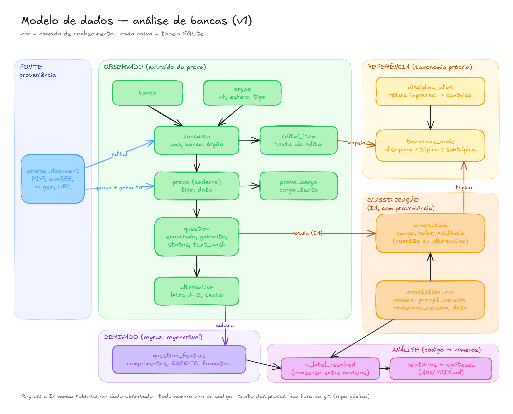

# Análise empírica de bancas de concurso

Projeto para estudar **como** as bancas formulam questões, e não só **o que** cobram. Ele separa o que
é observado na prova, o que é calculado por regra e o que é classificado por IA (sempre com
proveniência), e só aceita estatísticas calculadas por código.

Alvo atual: **Auditor da STC-MA** no Concurso Unificado do Maranhão (FCC), prova em 04/04/2027.
A arquitetura permite comparar bancas depois (FGV, Cebraspe, Vunesp…).

## Status
Especificação aprovada; o MVP ainda não foi implementado. Veja:

| Documento | Conteúdo |
|---|---|
| [docs/SPEC.md](docs/SPEC.md) | problema, perguntas de pesquisa, escopo, MVP |
| [docs/DATA_MODEL.md](docs/DATA_MODEL.md) | entidades, esquema SQLite, catálogo de variáveis |
| [docs/ARCHITECTURE.md](docs/ARCHITECTURE.md) | pipeline, uso de IA, validação, riscos |
| [docs/ANALYSIS.md](docs/ANALYSIS.md) | métodos estatísticos e registro de hipóteses |
| [docs/DECISIONS.md](docs/DECISIONS.md) | decisões arquiteturais (ADRs) |
| [docs/SETUP_IA.md](docs/SETUP_IA.md) | como configurar as chaves gratuitas de IA |

## Sobre os dados
Este repositório **não contém o texto de provas** nem PDFs: as questões pertencem às bancas. Ele
publica código, documentação, rótulos identificados por chave da questão e estatísticas agregadas.
O banco local é reconstruído a partir das fontes oficiais (site da banca).

## Licença
Código e documentação sob licença MIT (ver [LICENSE](LICENSE)).
