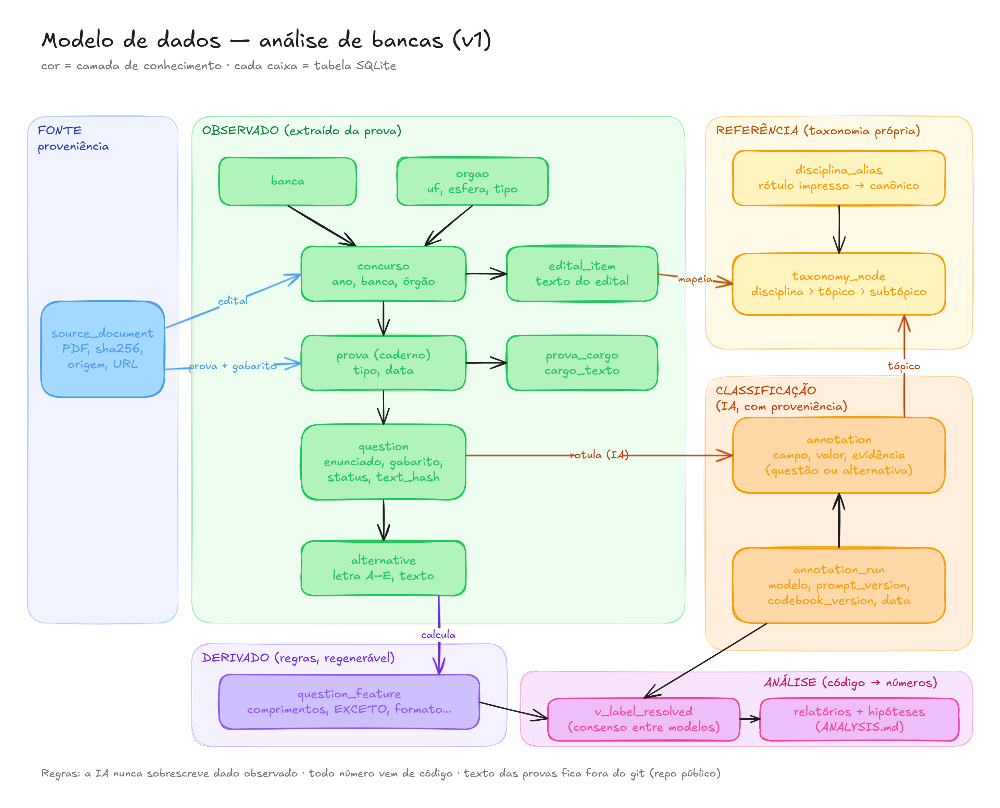

# DATA_MODEL — Entidades, esquema e catálogo de variáveis

> Status: **aprovada**. O DDL abaixo é especificação: ainda não foi aplicado a nenhum banco.



*Fonte editável: [diagrams/data_model.elements.json](diagrams/data_model.elements.json) (formato de
elementos do Excalidraw). Para regenerar o PNG: `node docs/diagrams/render.mjs` (instruções no cabeçalho do script).*

## 1. Entidades e relações

```
banca ──< concurso >── orgao
              │
              ├──< edital_item >── taxonomy_node        (o que o edital promete)
              │
              └──< prova (caderno) ──< question ──< alternative
                     │                    │
                     │                    ├──< question_feature        (derivado, regenerável)
                     │                    └──< annotation >── annotation_run   (IA ou humano)
                     │                              └─ valor pode apontar para taxonomy_node (tópico)
                     └── source_document (PDF da prova, gabarito, edital: proveniência)
```

Decisões de modelagem e o motivo de cada uma:

| Decisão | Motivo |
|---|---|
| **`prova` = um caderno físico**, não um cargo | Um caderno pode servir a vários cargos, e um cargo pode ter mais de um caderno (gerais e específicos). A unidade estatística natural para agrupar (*cluster*) é o caderno. |
| Cargo como texto em `prova_cargo` | Cargos têm nomes inconsistentes entre editais. Uma tabela de cargos normalizada seria engenharia prematura; `cargo_normalizado` resolve o agrupamento. |
| **Disciplina observada versus disciplina normalizada** | O cabeçalho da seção no caderno ("Noções de Direito Administrativo") é **observado**. O mapeamento para a disciplina canônica é uma tabela de correspondência determinística, sem IA. |
| **Tópico é anotação, não coluna** | A atribuição de tópico é interpretação. Deve carregar proveniência e poder ser auditada, como qualquer classificação. |
| **Anotação por questão ou por alternativa** | Distratores são propriedade de alternativas. `annotation.alternativa = ''` quando o rótulo vale para a questão inteira. |
| `question_feature` em formato longo e regenerável | Permite adicionar features sem migração. É apagada e recalculada sempre que o extrator muda de versão. |
| Taxonomia própria e versionada, com mapeamento para itens do edital | Os editais mudam de redação a cada concurso. Uma taxonomia estável permite comparar entre concursos e bancas; `edital_item` preserva o que o edital efetivamente disse. |
| Sem tabela de "estatísticas" | As estatísticas são sempre calculadas (views ou código) e nunca armazenadas como fato. |

## 2. Camadas e proveniência

| Camada | Tabelas | Quem escreve | Pode ser recalculada? |
|---|---|---|---|
| Fonte bruta | `source_document` (+ arquivo em `data/raw/`, identificado por hash) | ingestão | não: é a âncora |
| Observado | `banca`, `orgao`, `concurso`, `prova`, `prova_cargo`, `question`, `alternative`, `edital_item` | parser mais verificação humana | sim, a partir da fonte, mas exige verificação |
| Derivado | `question_feature` | código (`extractor_version`) | sim, automaticamente |
| Classificação | `annotation`, `annotation_run` | IA (humano reservado para o futuro) | sim, rodando os modelos de novo; ainda assim é exportada em JSONL versionado, porque modelos gratuitos podem sumir |
| Hipótese | `docs/ANALYSIS.md` (registro) | pessoa | — |

## 3. Esquema (SQLite)

> Convenções: `id INTEGER PRIMARY KEY`, datas em ISO-8601 (texto), `PRAGMA foreign_keys = ON`.
> Tabelas marcadas como **[pós-MVP]** só são criadas quando forem necessárias.

```sql
-- ===== Proveniência =====
CREATE TABLE source_document (
  id            INTEGER PRIMARY KEY,
  kind          TEXT NOT NULL CHECK (kind IN
                 ('prova','gabarito_preliminar','gabarito_definitivo','edital','retificacao','outro')),
  origin        TEXT NOT NULL,          -- 'fcc_site','orgao_site','diario_oficial','pci','manual'
  url           TEXT,
  retrieved_at  TEXT NOT NULL,
  sha256        TEXT NOT NULL UNIQUE,   -- identidade do arquivo; impede duplicatas
  local_path    TEXT NOT NULL,          -- relativo a data/raw/
  notes         TEXT                    -- termos de uso, observações de licença
);

-- ===== Dimensões =====
CREATE TABLE banca (
  id INTEGER PRIMARY KEY, sigla TEXT NOT NULL UNIQUE, nome TEXT
);

CREATE TABLE orgao (
  id INTEGER PRIMARY KEY,
  sigla TEXT NOT NULL, nome TEXT, uf TEXT,
  esfera TEXT CHECK (esfera IN ('federal','estadual','municipal')),
  tipo   TEXT          -- 'tribunal_contas','controladoria','fazenda','judiciario','executivo',...
);

CREATE TABLE concurso (
  id INTEGER PRIMARY KEY,
  banca_id INTEGER NOT NULL REFERENCES banca(id),
  orgao_id INTEGER NOT NULL REFERENCES orgao(id),
  ano INTEGER NOT NULL,                 -- ano de aplicação da prova
  nome TEXT,
  edital_document_id INTEGER REFERENCES source_document(id)
);

CREATE TABLE prova (                    -- um caderno
  id INTEGER PRIMARY KEY,
  concurso_id INTEGER NOT NULL REFERENCES concurso(id),
  data_aplicacao TEXT,
  tipo_caderno TEXT,                    -- ex.: 'Tipo 1'; gabaritos variam por tipo
  formato_resposta TEXT NOT NULL DEFAULT 'multipla_escolha'
                   CHECK (formato_resposta IN ('multipla_escolha','certo_errado')),
  n_questoes_esperado INTEGER,
  source_document_id INTEGER NOT NULL REFERENCES source_document(id),
  gabarito_document_id INTEGER REFERENCES source_document(id)
);

CREATE TABLE prova_cargo (
  prova_id INTEGER NOT NULL REFERENCES prova(id),
  cargo_texto TEXT NOT NULL,            -- exatamente como aparece no caderno ou edital
  cargo_normalizado TEXT,               -- ex.: 'auditor_controle'
  PRIMARY KEY (prova_id, cargo_texto)
);

-- ===== Taxonomia =====
CREATE TABLE taxonomy_node (
  id INTEGER PRIMARY KEY,
  parent_id INTEGER REFERENCES taxonomy_node(id),
  nivel TEXT NOT NULL CHECK (nivel IN ('disciplina','topico','subtopico')),
  slug  TEXT NOT NULL,                  -- 'dir_adm.atos.vicios'
  nome  TEXT NOT NULL,
  taxonomy_version TEXT NOT NULL,
  UNIQUE (slug, taxonomy_version)
);

CREATE TABLE disciplina_alias (         -- rótulo impresso no caderno -> disciplina canônica
  rotulo TEXT PRIMARY KEY,              -- 'Noções de Direito Administrativo'
  taxonomy_node_id INTEGER NOT NULL REFERENCES taxonomy_node(id)
);

CREATE TABLE edital_item (              -- [pós-MVP, mas recomendado cedo]
  id INTEGER PRIMARY KEY,
  concurso_id INTEGER NOT NULL REFERENCES concurso(id),
  disciplina_rotulo TEXT NOT NULL,
  ordem INTEGER, texto TEXT NOT NULL,
  taxonomy_node_id INTEGER REFERENCES taxonomy_node(id)   -- mapeamento (anotável)
);

-- ===== Questões (observado) =====
CREATE TABLE question (
  id INTEGER PRIMARY KEY,
  prova_id INTEGER NOT NULL REFERENCES prova(id),
  numero INTEGER NOT NULL,
  question_key TEXT NOT NULL UNIQUE,    -- chave natural pública: 'fcc-ma_unificado-2027-auditor_geral-t1-042'
                                        -- usada nos exports versionados (repo público, sem texto)
  disciplina_rotulo TEXT,               -- observado: cabeçalho da seção
  texto_base TEXT,                      -- texto de apoio compartilhado (ex.: Português), se houver
  enunciado TEXT NOT NULL,
  gabarito_preliminar TEXT,
  gabarito_definitivo TEXT,             -- NULL se anulada
  status TEXT NOT NULL DEFAULT 'valida' CHECK (status IN ('valida','anulada','alterada')),
  text_hash TEXT NOT NULL,              -- normalizado; detecta a mesma questão em cadernos diferentes
  extraction_method TEXT NOT NULL,      -- 'pdf_text','ocr','manual'
  verified_by_human INTEGER NOT NULL DEFAULT 0,
  UNIQUE (prova_id, numero)
);

CREATE TABLE alternative (
  question_id INTEGER NOT NULL REFERENCES question(id),
  letra TEXT NOT NULL,                  -- 'A'..'E' ou 'C'/'E'
  texto TEXT NOT NULL,
  PRIMARY KEY (question_id, letra)
);
-- "alternativa correta" não é armazenada: deriva de gabarito_definitivo (view).

-- ===== Derivado =====
CREATE TABLE question_feature (
  question_id INTEGER NOT NULL REFERENCES question(id),
  alternativa TEXT NOT NULL DEFAULT '', -- '' = questão inteira (NULL não garante unicidade no SQLite)
  name TEXT NOT NULL,
  value_num REAL, value_text TEXT,
  extractor_version TEXT NOT NULL,
  PRIMARY KEY (question_id, alternativa, name)
);

-- ===== Classificação (IA ou humano) =====
CREATE TABLE annotation_run (
  id INTEGER PRIMARY KEY,
  annotator_type TEXT NOT NULL CHECK (annotator_type IN ('llm','human','rule')),
  annotator_id TEXT NOT NULL,           -- 'claude-opus-5-5' ou identificador da pessoa
  prompt_version TEXT,                  -- hash ou tag do template de prompt (NULL para humano)
  codebook_version TEXT NOT NULL,
  params_json TEXT,                     -- effort, max_tokens etc.
  purpose TEXT,                         -- 'gold','producao','estabilidade','auditoria'
  blind INTEGER,                        -- humano: rotulou sem ver a IA? (1/0)
  started_at TEXT NOT NULL,
  notes TEXT
);

CREATE TABLE annotation (
  id INTEGER PRIMARY KEY,
  run_id INTEGER NOT NULL REFERENCES annotation_run(id),
  question_id INTEGER NOT NULL REFERENCES question(id),
  alternativa TEXT NOT NULL DEFAULT '', -- '' = rótulo da questão inteira
  campo TEXT NOT NULL,                  -- 'cenario','demanda_cognitiva','fonte_normativa','topico',...
  valor TEXT NOT NULL,                  -- código do codebook ou slug da taxonomia
  confianca REAL,                       -- autodeclarada pelo LLM (fraca) ou derivada de concordância
  evidencia TEXT,                       -- trecho do enunciado que justifica
  justificativa TEXT,
  created_at TEXT NOT NULL,
  UNIQUE (run_id, question_id, alternativa, campo, valor)   -- permite multirrótulo
);
```

Total no MVP: **12 tabelas**, das quais 4 são pequenas (banca, prova_cargo, disciplina_alias,
annotation_run). `edital_item` entra assim que houver edital-alvo.

### Views previstas (não são tabelas)
- `v_question_full`: questão com prova, concurso, banca, órgão, ano, período e disciplina canônica.
- `v_label_by_model`: um rótulo por (questão, campo, modelo), com consenso das 2 execuções do modelo.
  É a base da análise de sensibilidade.
- `v_label_resolved`: um rótulo por (questão, campo), seguindo a regra declarada
  **humano (se houver) > consenso entre os 2 modelos > nulo**. A regra fica em SQL, visível, e não
  espalhada em código.
- `v_question_dedup`: uma linha por `text_hash` dentro do mesmo concurso, para não contar duas vezes
  a mesma questão de "conhecimentos gerais" que aparece em cadernos de cargos diferentes.

### Exemplo: o modelo suporta o estimando pedido?
```sql
-- P(cenario = 'sim' | FCC, Direito Administrativo), por período, rótulo resolvido
SELECT periodo,
       AVG(l.valor = 'sim') AS p_cenario,
       COUNT(*) AS n, COUNT(DISTINCT q.prova_id) AS n_provas
FROM v_question_full q
JOIN v_label_resolved l ON l.question_id = q.id AND l.campo = 'cenario'
WHERE q.banca = 'FCC' AND q.disciplina = 'dir_adm' AND q.status = 'valida'
GROUP BY periodo;
```
O ponto estimado sai do SQL. O intervalo de confiança **não** sai daqui, porque precisa ser agrupado
por prova (ver [ANALYSIS.md §3](ANALYSIS.md)). Banca × órgão × tópico × período ficam todos
disponíveis como colunas de `v_question_full`, então o modelo suporta as quatro decomposições pedidas.

### Futuro (sem criar agora)
- `attempt(question_id, respondida_em, resposta, correta, tempo_s)`: histórico pessoal (Q11).
  Encaixa sem migrar nada, porque só referencia `question`.
- `law_text(norma, artigo, texto, vigencia)`: base de dispositivos legais para medir literalidade
  de forma objetiva (ver `literalidade_score` abaixo).

## 4. Catálogo de variáveis estruturais

Avaliação de cada campo sugerido no briefing. **Legenda:** O = observado, D = derivado por regra,
IA = classificação, ✗ = descartado ou adiado.

### 4.1 Mantidas e reorganizadas

Os campos "tipo de enunciado", "pergunta direta", "situação hipotética", "caso concreto",
"aplicação prática", "definição conceitual", "nível de abstração" e "tipo de raciocínio" se
sobrepõem. Eles foram reorganizados em **duas dimensões ortogonais**:

| Variável | Valores (codebook v0) | Camada | Por quê |
|---|---|---|---|
| `cenario` | `sem_cenario` · `cenario_hipotetico` (narra fatos, personagens ou órgão fictício) | **D + IA** | Grande parte é detectável ("Considere a seguinte situação hipotética", "João, servidor…"). A regra propõe e a IA ou o humano confirmam. "Situação hipotética" e "caso concreto" viram um único valor: a distinção entre eles não é operacionalizável de forma confiável. |
| `demanda_cognitiva` | `recordar_texto` (reconhecer o texto da norma) · `reconhecer_conceito` (definição, classificação doutrinária) · `aplicar_a_fatos` (subsumir os fatos à regra) · `calcular_ou_contar` (prazos, valores) | **IA** | Responde "teoria × aplicação". **Ponto-chave:** cruzar com `cenario` revela o **cenário decorativo**, em que a questão tem história mas só exige lei seca. Essa é provavelmente a resposta mais útil para Q1. |
| `fonte_normativa` | multirrótulo: `lei` · `constituicao` · `jurisprudencia` · `sumula` · `doutrina` · `indeterminada` | **IA** (+ D para menções explícitas) | Menções explícitas ("STF", "Súmula", "art. 37") são D. A jurisprudência implícita (a resposta segue o STF sem citá-lo) só aparece com IA e conferência humana. |
| `topico` / `subtopico` | slug da taxonomia | **IA** | É interpretação. É a variável com mais classes, logo a de menor concordância esperada. Aceitar concordância no nível de **tópico** e tratar subtópico como exploratório. |

### 4.2 Derivadas por regra (baratas, objetivas, entram no MVP)

| Variável | Definição operacional |
|---|---|
| `n_palavras_enunciado`, `n_palavras_alt_media`, `n_palavras_alt_max` | tokenização simples |
| `comando_polaridade` | `positivo` / `negativo`, por regex em INCORRETA, EXCETO, NÃO, ERRADA, *não* é…, em maiúsculas ou não |
| `comando_tipo` | `assinale_correta`, `assinale_incorreta`, `esta_correto_o_que_se_afirma` (I/II/III), `completa_corretamente`, `associacao`, `outro` |
| `formato_alternativas` | `simples`, `assertivas_combinadas` (I, II, III…), `lacunas`, `associacao_colunas`, `sequencia_VF` |
| `n_assertivas` | contagem de I, II, III… |
| `tem_data`, `tem_valor_monetario`, `tem_numero`, `tem_prazo` | regex |
| `cita_dispositivo` (art., §, inciso, Lei nº) e `cita_tribunal` (STF, STJ, TCU, súmula) | regex |
| `negacao_em_alternativas` | contagem de negações por alternativa |
| `posicao_correta`, `correta_e_mais_longa`, `rank_comprimento_correta` | exigem gabarito; testam o viés "a mais longa é a certa" |
| `absolutos_em_alternativas` | sempre, nunca, somente, exclusivamente, em qualquer hipótese (marcador clássico de distrator) |

"Presença de negação" e "presença de EXCETO" do briefing viram `comando_polaridade` (no comando)
e `negacao_em_alternativas` (no corpo). São fenômenos diferentes com efeitos diferentes.

### 4.3 Adiadas (fase 2)

| Variável | Por que adiar |
|---|---|
| `tipo_distrator` (por alternativa) | É a variável mais subjetiva. Exige conhecer o gabarito e a matéria, e a concordância esperada é baixa. Fazer piloto de 30 questões para medir κ antes de investir. Codebook candidato: `troca_de_termo`, `troca_de_numero_prazo`, `extrapolacao_absoluta`, `inversao_regra_excecao`, `instituto_trocado`, `conceito_certo_contexto_errado`, `verdadeira_mas_nao_responde`. |
| `literalidade_score` | Medição **objetiva** de lei seca: similaridade textual (por exemplo, *token set ratio*) entre a alternativa correta e o dispositivo legal mais próximo em uma base `law_text`. Substitui a pergunta subjetiva "é literal?" por um número. Exige montar a base de leis (Planalto). Alto valor, custo médio. |
| `n_personagens` | Aproximável por nomes próprios, mas de baixo valor analítico isolado. Fica coberto por `cenario`. |
| `presenca_orgao_publico` | Baixo valor. Volta se surgir uma hipótese que precise dele. |

### 4.4 Descartadas

| Variável | Motivo |
|---|---|
| `nivel_abstracao` | Sem definição operacional que dois avaliadores apliquem igual. Absorvida por `demanda_cognitiva`. |
| "Dificuldade" atribuída por IA | Seria uma opinião do modelo, não uma medida. Dificuldade real vem de dados de acerto, que não temos (o histórico pessoal pode fornecê-los). |

## 5. Codebook

Cada variável de classificação é definida em `codebook/v{N}.yaml` com: definição, valores,
regras de decisão para casos de fronteira e 2 exemplos positivos e 2 negativos por valor.
**O mesmo codebook alimenta os dois modelos** (e um eventual revisor humano), o que é condição para
a concordância medida significar alguma coisa. Mudanças de definição geram nova versão; rótulos antigos permanecem,
ligados à versão antiga.
